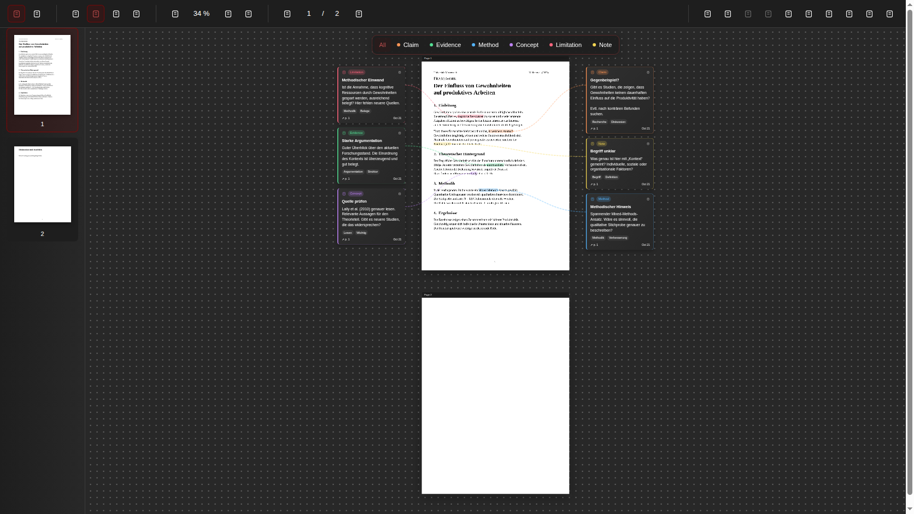

# Remark My Words

**Read a PDF. Mark a passage. Give your thoughts room.**

Remark My Words is an Obsidian community plugin for reading and annotating PDFs.
Write categorized comments beside passages and arrange every PDF page with its
comments on one interactive canvas.
Use it for manuals, reports, books, articles, and other PDF documents in your vault.



*Canvas preview with a sample document in the browser test harness.*

## Read closely, think spatially

| Reading mode | Canvas mode |
| --- | --- |
| Focus on one PDF page with normal scrolling. | Arrange all PDF pages on one canvas. |
| Select a passage and add a comment from the floating toolbar. | Move pages and comment cards, create groups, and use native menus. |
| Click a highlight or open comments in the right sidebar. | Jump to a moved page from the left sidebar. |
| Keep your reading position when saving a comment. | Rearrange pages vertically with comments on both sides. |

Use the default categories or create your own categories for each annotation.
Each comment can have a title, description, and tags.
Page thumbnails and document-wide notes are included.

## Install

Requires **Obsidian 1.13.7 or later**, using an up-to-date app or desktop installer.
Mobile installation is enabled for testing. iPhone/iPad testing requires iOS/iPadOS
17.4 or later; compatibility with the actual Obsidian mobile app is still being
verified. Browser simulations cover PDF rendering and basic comment workflows,
but do not certify native text selection, the on-screen keyboard, or vault storage.

Install **Remark My Words** from **Settings → Community plugins → Browse**.
The PDF renderer is bundled with the plugin, so no additional download is needed.

## Get started

1. After installing, enable **Remark My Words** under **Settings > Community plugins**.
2. Run **Remark My Words: Open PDF** from the command palette or click the pen-and-file ribbon icon. The active PDF opens immediately; otherwise choose a PDF from the vault. You can also right-click a PDF and choose **Open in Remark My Words**.
3. Choose **Reading mode** for one page at a time or **Canvas mode** for the whole document. Canvas initially fits the first page; **Fit PDF and comments** opens the full overview. Returning from Reading restores your previous Canvas camera. Both modes support passage selection and comments.
4. Select text, click a category in the floating toolbar, and fill in **Add comment**. Right-clicking selected text also offers categories.
5. In Reading, click a highlighted passage to open its comment, then use **Edit** or **Delete** as needed. **Read page comments** opens a dockable right sidebar that follows page navigation and supports editing and deletion.
6. In Canvas, click to select one item; Ctrl/⌘-click or Shift-click adds or removes items. Drag a page by its title bar or a comment by its header; dragging a selected item moves the whole selection. Drag a selection rectangle on the background, holding Ctrl/⌘ or Shift to extend the selection. On touchscreens, enable **Select multiple items** and tap the items. Group the selection from **Canvas actions** or the right-click menu. Drag the group title to move its members together. The page thumbnails on the left jump to each page's current position. **Rearrange pages and comments** stacks pages vertically with comments on both sides, calculating spacing from their heights and preserving groups.

Canvas uses the same PDF text layers, highlights, comments, and passage connections
as Reading. Right-click opens Obsidian menus for the page, comment, group, or
background. The **Canvas actions** toolbar menu provides grouping and selection
actions on touchscreens. **Undo/Redo canvas change**, next to page navigation,
restores layout operations; **Snap to grid
and objects** enables alignment, with Alt temporarily bypassing it while dragging.
Double-click a group title to rename it; **Ungroup selection** keeps its members.

The first page becomes usable while the remaining page sizes are prepared in the
background. Large comment collections only build cards near the visible area,
and recently viewed pages use a limited cache for faster back navigation.

The layout is saved in the existing annotation JSON file. Older `.remark.canvas`
files from version 0.3.0 remain untouched and can still be opened in Obsidian.
Their independent edits are not imported into this unified PDF view.

Navigate pages with thumbnails, arrows, or the page number. In Reading, mouse-wheel
scrolling past the bottom opens the next page at its top, or past the top opens the
previous page at its bottom. On touchscreens, use the page controls to change pages.
Deleting a comment asks for confirmation.

## Customize

Click **Customize** in the PDF toolbar. The same manager is available from
**Settings > Remark My Words** and the command palette. Choose the plugin
interface colors for the background, panels, borders, text, secondary text, and
accent states. You can also add a category, change its name, color, or icon,
move it up or down, or delete it; then choose **Save**. Category order applies to
selection tools, filters, and comment menus. **Cancel** leaves the previous
settings unchanged.

The initial categories remain **Claim, Evidence, Method, Concept, Limitation,
and Note**. Changes apply across PDFs in this vault and survive restarting
Obsidian. Keep at least one category. Deleting a category removes it from new
comment choices; existing comments keep their category and remain editable.
An existing deleted category appears as **(deleted)** in the comment editor.

## Your data stays in your vault

The plugin does not send PDFs, comments, or notes to an external service. It has
no accounts, telemetry, or paid features. Normal reading and annotation do not
make network requests. Plugin installation and updates are handled by Obsidian
and GitHub.

Comments and notes are stored beside the PDF in a readable JSON file:

```text
document.pdf
document.pdf.obsidian-annot.json
```

The original PDF is not modified. Keep the PDF and its annotation file together
when moving or backing up your documents. Renaming the PDF currently requires
renaming its annotation file to match. Your vault's existing sync service can
sync these files; the plugin does not provide its own synchronization.

## Keyboard shortcuts

On touchscreens, spread or pinch two fingers over the PDF to zoom around their
midpoint. In Reading, one finger scrolls the page; in Canvas, drag the background
or use the hand tool to pan with one finger.

| Shortcut | Action |
| --- | --- |
| V / H | Select text / pan canvas |
| + / − | Zoom in / out |
| Ctrl/⌘ + wheel | Zoom around the pointer |
| 0 | Fit page and cards in Canvas; fit page width in Reading |
| Page Up / Page Down | Previous / next page |
| Escape | Dismiss a preview or clear the selection |
| Arrow keys on selected items | Move by 10 units; Shift moves by 50 |
| Ctrl/⌘ + A | Select all pages and comments in Canvas |
| Ctrl/⌘ + G / Shift + G | Group / ungroup selection in Canvas |
| Ctrl/⌘ + Z / Shift + Z | Undo / redo Canvas layout changes |
| Enter on a focused card | Edit the comment |
| Ctrl/⌘ + Enter in the description field | Save the comment |

## Export selected comments

In Canvas, select one or more comments, pages, or groups, then choose
**Export selection…** from **Canvas actions** or the right-click menu.
Use **Select all pages and comments** first to include the entire document's comments.
A selected page includes every comment on that page, including comments hidden
by category filters. Selecting both a page and one of its comments exports that
comment once. The dialog shows the number of comments and pages in the selection.

Choose one combined Markdown file (organized by PDF page, with a heading for each
comment) or one Markdown file per comment. Exports include titles, quotes,
comment text, category labels, tags, a link to the PDF page, and a link back to the
original comment in Remark My Words. General document notes are optional; in
individual-file mode they get their own file. The folder defaults to a new notes
folder next to the PDF; leave the folder field empty to use the vault root.

Existing notes are never overwritten: repeated exports and duplicate names get
numbered file names. If writing fails partway through, **Retry export** continues
with the remaining files while the dialog is open. Canceling after a partial
export keeps the files already created. Exports are independent snapshots;
editing them does not update the PDF comments. The PDF and annotation sidecar
remain unchanged. Exported Markdown notes can be added to a native Obsidian Canvas.

## Current limits

- The unified Canvas is a plugin view with PDF annotation tools and Obsidian menus. It does not embed Obsidian's complete Canvas editor or support arbitrary native Canvas cards.
- Undo/redo covers layout changes in the current session. Comment deletion still requires confirmation and cannot be undone.
- Scanned documents need an existing text layer; OCR is not included.
- Annotations live in the JSON file, not as native annotations inside the PDF.
- Concurrent edits to the same PDF from multiple views or devices are not merged.
- Mobile installation is available for testing; compatibility in the actual Obsidian iOS and Android apps has not yet been verified.

## Feedback and development

[Report a bug or request a feature](https://github.com/hoelk-f/remark-my-words/issues).
For bugs, include your Obsidian version, plugin version, operating system, and
steps to reproduce. Share only non-sensitive sample documents.

- [Contributing](CONTRIBUTING.md)
- [Development, architecture, and data format](docs/DEVELOPMENT.md)
- [Release and Community directory submission guide](docs/RELEASING.md)
- [Changelog](CHANGELOG.md)

## License

Remark My Words is released under the [MIT License](LICENSE).
PDF rendering uses Mozilla's [PDF.js](https://mozilla.github.io/pdf.js/), licensed
under [Apache 2.0](docs/licenses/pdfjs-dist.txt). License notices are retained in
the distributed bundle. See [third-party notices](THIRD_PARTY_NOTICES.md).

This is an independent community project, not an official Obsidian product.
